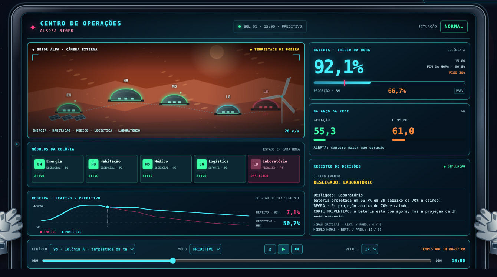
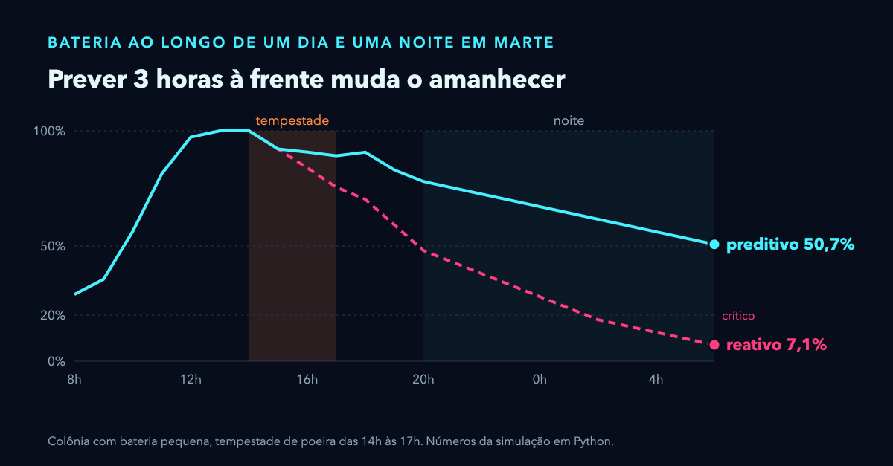
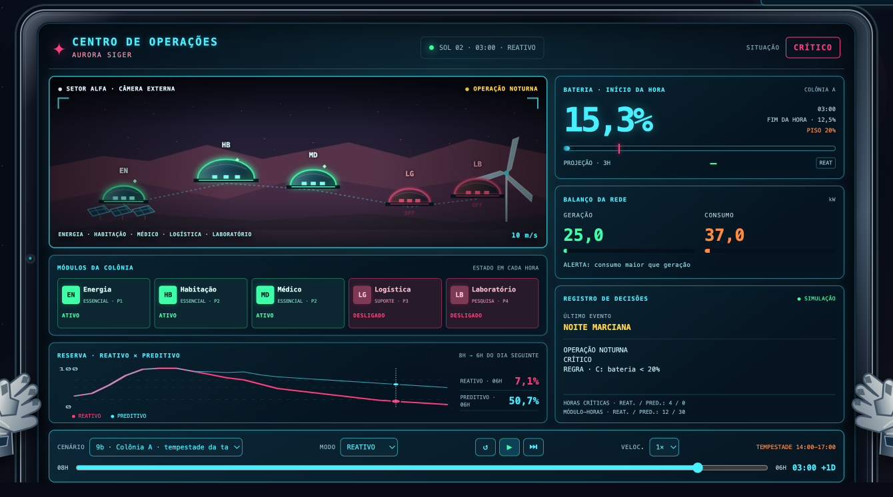

# Aurora Siger — Sistema Inteligente da Colônia

A colônia está em Marte, e a Terra está longe demais para dar ordens em tempo real. Este sistema **organiza os dados dos sensores, prevê a geração de energia, analisa geração × consumo e decide sozinho** o que ligar e desligar, sempre protegendo o suporte à vida.

A ideia central: sair de um sistema **reativo** (que age depois que a bateria já caiu) para um sistema **preditivo** (que projeta a bateria **3 horas à frente**, de hora em hora, e corta antes de a reserva ficar perigosa).

<p align="center">
  <a href="https://mrc888.github.io/aurora-colonia/painel/"></a>
</p>

<p align="center"><b>Painel ao vivo, sem instalar nada:</b> <a href="https://mrc888.github.io/aurora-colonia/painel/">mrc888.github.io/aurora-colonia/painel</a></p>

<p align="center">
  <a href="https://mrc888.github.io/aurora-colonia/painel/"></a>
</p>

**Equipe:** Alice Brenda (RM 574916), Douglas Goltz (RM 574439) e Marcelo Santos (RM 576131) · Ciência da Computação · FIAP · 2026

## Como executar

Requer só o Python 3, sem nenhuma biblioteca externa. No macOS, use `python3` no lugar de `python`.

```text
python main.py            # abre o menu: digite a opção (ex.: 1, 9b, todos) e Enter
python painel.py          # grava painel/dados.js com todos os números para o painel
python -m unittest discover -s tests -t .     # 162 testes
```

Para abrir o painel no computador, rode `python painel.py` e abra `painel/index.html` direto no navegador, sem servidor. Os quatro arquivos da pasta `painel/` precisam ficar juntos.

Opções do menu:

| Opção | O que mostra |
|---|---|
| `1` a `8`, `10a`, `10b`, `11` a `21` | Os 21 cenários prontos |
| `9a` a `9d` | As 4 simulações do dia e da noite (reativo × preditivo) |
| `arv` | A árvore de dados da colônia e a busca por chave |
| `fis` | Vento: reta × curva calibrada × fórmula pura |
| `pnl` | Exporta os números para o painel |
| `todos` | Mostra cenários, simulações, árvore e vento |
| `sair` | Encerra |

## Como funciona

```text
ENTRADA (sensores) → validar → anomalias → previsão → energia → decisão → ação → diário
```

1. **Dados** (`dados.py`, `colonia.py`): a colônia é uma **árvore de dicionários** (energético → solar / eólico / bateria; ambiental; operacional → módulos e alertas de falha). Cada módulo guarda uma **lista** com o consumo esperado em cada hora do dia. A leitura é validada antes de tudo.
2. **Previsão** (`previsao.py`): é **híbrida**.
   - **Eólica:** regressão linear por **mínimos quadrados**, feita à mão (vento 11 m/s → 27,5 kW, R² = 1). Uma medição real entra no histórico e refaz a reta.
   - **Solar:** a curva do dia (parábola) vezes um **fator de poeira**, que é o medido dividido pelo esperado.
3. **Energia** (`energia.py`): balanço geração × consumo, detecção de **anomalias** (um andar gastando mais de 30% acima do esperado) e a **projeção da bateria em 3h**.
4. **Decisão** (`regras.py`): quatro variáveis lógicas.
   - **C:** bateria < 20%
   - **B:** bateria < 50%
   - **A:** consumo > 80 kW
   - **P:** projeção < 70% e caindo

   Com elas: `ECONOMIA = B·A`, `RISCO = B·A·P`, `EMERGÊNCIA = C + RISCO`.
   O corte começa por quem causou a anomalia e depois segue a prioridade. O religar usa histerese (2h desligado e projeção ≥ 80%). Energia, Habitação e Médico **nunca** são desligados: nem um cenário pode começar com eles fora.
5. **Sistema** (`sistema.py`, `main.py`): junta tudo, explica cada decisão e registra no diário.
6. **Simulação** (`simulacao.py`): um dia das 8h às 20h com uma tempestade de poeira de 3h, seguido da noite até as 6h, hora a hora. Roda em **2 colônias** (bateria de 440 kWh e de 1100 kWh) × **2 tempestades** (manhã e tarde), sempre com reativo × preditivo.

## Exemplo de entrada e saída (cenário 1 do enunciado)

```text
ENTRADA
  hora 19 h · bateria 40 % · solar 0 kW · vento 10 m/s · colônia B
  consumo medido: 70,0 kW

PREVISÃO
  reta eólica: ŷ = 0,00 + 2,50·vento   (R² = 1,00)
  eólica prevista: 25,0 kW · fator de poeira: 1,00
  bateria projetada em 3h: 31,9 %

ENERGIA
  geração 25,0 kW · consumo 70,0 kW
  ALERTA: consumo maior que geração

DECISÃO
  regra usada: B: bateria < 50% · P: projeção abaixo de 70% e caindo
  ALERTA: reduzir consumo

AÇÕES
  - Desligado: Laboratório — motivo: bateria projetada em 31,9% em 3h (abaixo de 70% e caindo)
  - Desligado: Logística — motivo: bateria projetada em 31,9% em 3h (abaixo de 70% e caindo)
  - ATENÇÃO: só restou o suporte à vida; reserva projetada em 35,8%
  consumo depois das ações: 47,0 kW · projeção depois: 35,8 %
```

Os outros exemplos do enunciado também estão no menu:
- **Cenário 2:** geração 40 kW, consumo 70 kW → `ALERTA: consumo maior que geração`.
- **Cenário 3:** geração 80 kW, consumo 30 kW → `SUGESTÃO: armazenar energia excedente`.
- **Cenário 4:** vento 11 m/s → eólica prevista de 27,5 kW.

## Resultado: reativo × preditivo

Mesma tempestade nos dois sistemas, do dia até o amanhecer das 6h:

<p align="center"></p>

| Reativo às 3h: CRÍTICO | Preditivo às 3h: NORMAL |
|---|---|
|  |  |

Todos os números:

| Simulação | Reativo: 20h → 6h | Preditivo: 20h → 6h | Piso | Horas em CRÍTICO (reat. × pred.) | Módulo-horas desligados (reat. × pred.) |
|---|---|---|---|---|---|
| 9a — Colônia A, tempestade da manhã | 72,4% → 22,4% | 79,3% → 52,0% | 20% | 0 × 0 | 8 × 30 |
| 9b — Colônia A, tempestade da tarde | 48,0% → **7,1%** | 78,0% → 50,7% | 20% | **4** × 0 | 12 × 30 |
| 9c — Colônia B, tempestade da manhã | 64,5% → 44,5% | 74,7% → 63,4% | 50% | 0 × 0 | 4 × 28 |
| 9d — Colônia B, tempestade da tarde | 63,1% → 43,1% | 73,5% → 62,6% | 50% | 0 × 0 | 0 × 26 |

O que os números mostram:
- O preditivo corta **durante a tempestade**, assim que a projeção fura 70%: na 1ª hora da 9c, na 2ª da 9b e na 3ª da 9d. Na 9a os módulos já estavam fora desde as 9h, por MODO ECONOMIA.
- Nos quatro casos, o preditivo amanhece acima do piso. O reativo só consegue isso na 9a.
- De dia, nenhum sistema chega ao CRÍTICO. O problema do reativo aparece de madrugada: na 9b, ele entra em CRÍTICO às 2h.
- **O custo:** o preditivo mantém módulos desligados por mais tempo. A energia guardada vem de Laboratório e Logística parados.

## Estrutura do repositório

| Arquivo | Papel |
|---|---|
| `dados.py` | constantes, níveis de consumo, jornada, colônias e tempestades (só dados) |
| `colonia.py` | árvore: buscar, percorrer (recursivo), somar, validar a leitura |
| `previsao.py` | média, mínimos quadrados, R², curva solar, fator de poeira |
| `energia.py` | balanço, anomalias, falhas, física do vento (P = ½·ρ·A·v³), projeção da bateria |
| `regras.py` | variáveis lógicas, decisão, corte e religar |
| `sistema.py` | o fluxo completo de uma leitura e o diário |
| `simulacao.py` | o dia e a noite, reativo × preditivo, as 4 simulações |
| `cenarios.py` | os cenários prontos do menu, cada um com a saída esperada |
| `painel.py` | exporta `painel/dados.js` (o painel só mostra, não recalcula) |
| `painel/` | o Centro de Operações em HTML ([ao vivo](https://mrc888.github.io/aurora-colonia/painel/)), um tablet em primeira pessoa: `index.html` (estrutura), `styles.css` (visual), `app.js` (controles e desenho) e `dados.js` (números gerados pelo Python) |
| `main.py` | menu do avaliador e relatório |
| `tests/` | 162 testes automáticos (`unittest`) |
| `algoritmo_v1.md` | o algoritmo em português: **fonte da verdade** |
| `docs/DECISOES_03-11-2026.md` | registro da reunião de 03/11 e o porquê de cada decisão |
| `docs/imagens/` | prints do painel e o gráfico usados neste README |
| `docs/VISUAL.md` | proposta de visual do painel HTML, do PDF e da apresentação, mais a decisão final do painel (seção 0) |
| `ROADMAP.md` | enunciado detalhado, marcos, divisão de tarefas e critérios de avaliação |
| `CLAUDE.md`, `.claude/agents/` | regras do projeto e agentes de revisão |

## Limites do protótipo

- Os valores são **hipóteses didáticas**, não medições reais de Marte. O ar marciano tem cerca de 1% da densidade do ar da Terra, então o vento real gera bem menos.
- A fórmula pura P = ½·ρ·A·v³, com os valores do projeto, dá só 1,2 kW a 10 m/s. Os 25 kW do enunciado são uma hipótese didática.
- A reta eólica foi ajustada com vento de 8 a 12 m/s. Usá-la a 20 m/s, na tempestade, é **extrapolação**. Partindo dos 25 kW, uma curva proporcional a v³ daria 4 vezes mais energia a 20 m/s. A reta é conservadora em relação a essa curva, o que protege a bateria.
- R² = 1 não prova que o modelo é ótimo: três pontos alinhados sempre dão 1.
- A projeção supõe que o vento e a poeira medidos agora **se mantêm** pelas próximas 3h. Por isso o preditivo não enxerga a tempestade antes de ela começar.
- A bateria das 8h é um valor fixo (29% e 53%). O modelo é por hora, então um dia não emenda exatamente no outro.
- Em testes de estresse fora das 4 simulações oficiais (ex.: Colônia B com bateria de 11% a 16% às 8h e tempestade da tarde), um módulo pode religar e sair de novo 1 hora depois.

## Recursos fora dos capítulos

A lógica usa os conceitos dos capítulos: funções, módulos, recursão, dicionários, listas, `if/elif/else`, álgebra booleana e mínimos quadrados. Sem classes, sem NumPy e sem bibliotecas externas.

Alguns recursos simples de Python foram usados sem aparecer nos textos dos capítulos:
- **Métodos de texto, lista e dicionário:** `.get`, `.split`, `.join`, `.insert`, `.replace`, `.strip`, `.startswith`, `dict()` e o corte `[:3]`.
- **Uma função devolver dois valores** (`return a, b`) e `if __name__ == "__main__"`.
- **`main.py`:** `sys`, `try/except` e alinhamento em f-strings, só para o menu funcionar bem.
- **`painel.py`:** `json`, `os` e `with open`, só para gravar o arquivo do painel.
- **`tests/`:** `unittest` e outras ferramentas da biblioteca padrão, com `class`, só para conferir o sistema.
